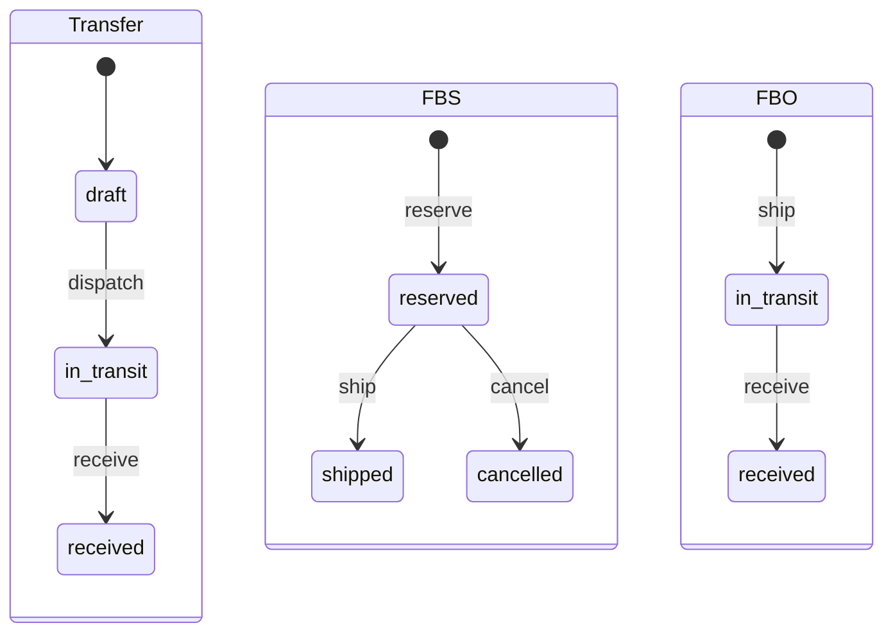

# Решения CheckStock

Контракт: CHECKSTOCK_CODEX_PLAN.md, разделы 0–10. Ниже — проектные договорённости раздела 3, а не цитаты из исходного PDF.

## Границы и архитектура

Один магазин; один SKU и положительное целое количество в операции, только полные отгрузки и приёмки. Python, синхронный FastAPI, SQLAlchemy 2 + psycopg, PostgreSQL, Alembic. PostgreSQL — единственный источник истины. Jinja2 и локальные CSS/JavaScript без frontend-сборки и CDN. Нет интеграций, ролей, частичных приёмок, возвратов, очередей или расчётов закупок. Локальный прототип без аутентификации; публиковать в интернете нельзя. FBS остаётся в пути после shipped: подтверждение доставки за рамками MVP.

## Состояния и изменения количества

| Команда | Физически у источника | Резерв FBS | Транзит | Физически у получателя |
|---|---:|---:|---:|---:|
| receipt completed | +q на выбранном ФФ | 0 | 0 | — |
| transfer create draft | 0 | 0 | 0 | 0 |
| transfer dispatch | −q | 0 | +q между ФФ | 0 |
| transfer receive | 0 | 0 | −q между ФФ | +q |
| FBS reserve | 0 | +q | 0 | — |
| FBS cancel | 0 | −q | 0 | — |
| FBS ship | −q | −q | +q клиенту | — |
| FBO ship | −q | 0 | +q маркетплейсу | — |
| FBO receive | 0 | 0 | −q маркетплейсу | 0 (маркетплейс вне ФФ) |

Нули в таблице означают отсутствие изменения. Доступно = on_hand − reserved_fbs; резерв уже входит в физический запас и не прибавляется к нему. Транзит вычисляется только из операций: transfer/in_transit, fbo/in_transit, fbs/shipped. FBO received отражает местонахождение на маркетплейсе в операции и истории, не в остатках ФФ. Создание transfer не резервирует запас; наличие проверяется при dispatch. Получить draft нельзя.

Создание черновика transfer атомарно записывает операцию со статусом draft и ровно одно событие transfer_created. Событие фиксирует SKU, количество, источник, получателя, UTC-время, ID операции и статус draft; физический остаток, резерв и транзит не меняются. Идемпотентный повтор create возвращает прежнюю операцию без нового события. Полный жизненный цикл transfer содержит три события: transfer_created, transfer_dispatched и transfer_received — по одному на создание, отправку и приёмку.

## Архивация и история

Удаление — установка archived_at, без hard-delete. ID и остатки сохраняются; матрица включает все товары × все склады, в том числе архивные и нулевые сочетания. Новый приход, FBS-резерв, FBO и новое входящее перемещение на архивный ФФ запрещены. Исходящий transfer на активный ФФ разрешён. Уже созданные операции можно завершить, включая приёмку на позднее архивированный склад, отправку и отмену ранее созданного FBS. Арифметический available архивного склада не даёт права на новый резерв. Переименование не меняет ID; журнал сохраняет снимки имён на момент каждого события. Журнал append-only, у событий есть SKU, количество, источник, назначение, UTC-время, ID и статус операции на момент события.

## Транзакции, блокировки, идемпотентность

Сервис не делает commit: вызывающий код выполняет целую команду в одной session.begin(). Проверка, изменение баланса, статус и событие коммитятся вместе; любая ошибка откатывает всё. Для создания используется обязательный idempotency_key, глобально уникальный среди операций, и SHA-256 нормализованного payload с видом операции. Транзакционная advisory-блокировка ключа сериализует одинаковые create; UNIQUE остаётся гарантией БД. Тот же ключ и payload возвращают прежнюю операцию, изменённый payload — 409. При повторе create проверка идемпотентности предшествует проверке текущего состояния склада.

Порядок блокировок: ключ создания или строка существующей операции FOR UPDATE, затем склады по возрастанию ID, затем балансы по (product_id, warehouse_id). Блокировки складов согласуют архивацию/переименование с созданием и завершением операций. Отсутствующий баланс создаётся INSERT ON CONFLICT DO NOTHING, затем SELECT FOR UPDATE. Списание всегда только с выбранного ФФ, без fallback. Повтор перехода определяется уже записанным событием (включая dispatch после receive); возвращается текущее состояние, без повторного эффекта. Противоположный переход FBS после ship/cancel — 409.

## Инварианты и ограничения

- on_hand >= 0; reserved_fbs >= 0; reserved_fbs <= on_hand; qty > 0.
- Уникальны SKU, пара product_id/warehouse_id, idempotency_key, пара operation_id/event_type.
- kind/status и форма источника/назначения согласованы через CHECK; источник transfer отличается от назначения.
- FK без CASCADE на удаление; времена timestamptz UTC.
- transfer/FBO расходуют только available_here; FBS ship расходует собственный резерв.
- Ошибочная команда не создаёт частичного баланса, статуса или события.
- События запрещено UPDATE/DELETE/TRUNCATE на уровне PostgreSQL; демоприходы создаются тем же сервисом, что обычные приходы.
- Тесты работают в отдельной случайной PostgreSQL-схеме с отдельной миграцией; удаление разрешено только своей схеме test_checkstock_<uuid>. Рабочая public не очищается.

## Ошибки и демонстрационные данные

422 — формат, дробь/ноль/отрицательное количество, совпадающие источник и получатель transfer; 404 — неизвестные SKU/ФФ/операция; 409 — локальный дефицит (available_here, requested), архив, неверный переход, конфликт ключа. Пользователь получает русское объяснение. Строгий int отвергает bool и строки для количества. Совпадение источника и получателя transfer отклоняется валидацией команды до обращения к ограничению CHECK в БД.

Seed запускается явно: три товара и ФФ Север/Юг; четыре положительных прихода 10, 6, 5, 4, всего 25. Нули не создают событий прихода. Идентификаторы справочников и стабильные ключи seed обеспечивают повторяемость, в том числе после переименования склада. Запуск приложения выполняет миграции, но сам не включает демоданные. Docker хранит PostgreSQL в именованном томе.

## Уточнения реализации

Все идентификаторы — UUID; справочники demo имеют детерминированные UUIDv5, обычные записи — UUIDv4. Это предотвращает конфликт seed с ранее созданными складами и не привязывает повтор к имени. Команды используют READ COMMITTED и блокировки; блокирующие ORM-запросы перечитывают поля через populate_existing. В небольшом прототипе блокировка склада также сериализует команды разных SKU этого ФФ: осознанный компромисс в пользу простоты согласования с архивацией. Для согласованного отчёта вызывающий код использует новую сессию и устанавливает REPEATABLE READ до первого SQL, чтобы матрица и транзит отражали один снимок, даже если параллельно идёт отправка. Сервисы чтения не меняют изоляцию и не выполняют commit; HTTP-граница подключается на этапе D. Количества ограничены положительным PostgreSQL integer; переполнение итогового баланса отклоняется как доменный конфликт.

## Граница реализации этапа B

Этап B поставляет инфраструктуру, полную схему и реальный сервис прихода, необходимый для demo seed. Сервис прихода используется без HTTP-маршрута; команды перемещений, FBS/FBO и управления складами реализуются на этапе C, бизнес-API — на D, интерфейс — на E. Сейчас приложение предоставляет только проверку здоровья с обращением к PostgreSQL. Это последовательная реализация контракта, а не заглушки бизнес-функций.

Seed выполняется одной транзакцией и сохраняет стабильные идентификаторы после переименования или архивации уже заполненного demo-склада. Совпавший SKU с другим ID отклоняется как конфликт, без подмены товара и частичного заполнения. У нулевых сочетаний SKU/ФФ может отсутствовать строка баланса: все шесть сочетаний проверяются через CROSS JOIN справочников и COALESCE, без фиктивных нулевых приходов.

Уточнение P3 этапа A о событии transfer_created включено в документы этапа B. Сценарии T04/T13 должны проверять это поведение при реализации сервиса перемещений на этапе C; этап B не заявляет, что эти команды уже работают.

## Граница реализации этапа C

Этап C реализует команды перемещений, FBS/FBO, создание/переименование/архивацию складов и сервисы чтения остатков, транзитов, операций и истории. Схема, миграция и зависимости этапа B сохраняются. Полный цикл transfer теперь включает transfer_created; черновик не проверяет и не резервирует запас, dispatch проверяет актуальную локальную доступность. Приёмка с переполнением PostgreSQL integer отклоняется целиком, сохраняя товар в транзите.

Названия склада, клиента и маркетплейса обрезаются по краям, затем должны содержать от 1 до 200 символов. Ключ идемпотентности остаётся непрозрачной строкой: пробелы по краям не удаляются, но пустой/пробельный ключ запрещён, длина не больше 200. Во всех этих строках запрещены NUL и одиночные суррогатные символы Unicode, не представимые в PostgreSQL text/UTF-8; ошибка возвращается как 422 до обращения к БД. Это уточнение валидации существующих полей, без расширения доменных сценариев. Формат UUID и HTTP-тела проверяются схемами этапа D; сервисы принимают типизированные UUID.

T01–T13 проверяются прямыми вызовами сервисов на реальном PostgreSQL. Коды 404/409/422 на этом этапе принадлежат DomainError, а не уже подключённым HTTP-обработчикам. Сквозная проверка API/Swagger относится к D, UI — к E, финальная сдача T14 — к F. Устаревшие черновики последующих этапов должны учитывать эту границу и проверки до включения в кандидата.

## Защита отчётов в этапе D

По результату P3 ревью C в этап D включено усиление сервисов чтения; в PR этапа C оно не входило. Перед чтением матрицы, операций или истории сервис проверяет фактическую изоляцию текущей транзакции PostgreSQL: допускаются REPEATABLE READ и SERIALIZABLE. При более слабой изоляции возникает явная ошибка интеграции RuntimeError; это нарушение контракта вызывающего кода, а не доменная ошибка пользовательской операции. Сервис не меняет изоляцию и не выполняет commit/rollback вместо вызывающего кода.

Запросы отчётов обновляют уже загруженные объекты SQLAlchemy через populate_existing, включая названия товаров и складов в проекции операций. Поэтому объекты, оставшиеся после предыдущего commit при expire_on_commit=False, не смешиваются со свежими строками отчёта. Для HTTP-отчётов D по-прежнему следует открывать новую сессию с REPEATABLE READ до первого SQL. Сериализация одной только что изменённой операции остаётся допустимой в её транзакции READ COMMITTED; защитная проверка применяется к составным отчётам.

## Граница HTTP API этапа D

Все маршруты раздела 6 плана вызывают сервисы учёта; бизнес-правила не дублируются в обработчиках. Сессия создаётся на запрос, изменение выполняется в одной session.begin(), проекция результата формируется внутри транзакции. Успешное создание и повтор команды возвращают HTTP 200 с ID и текущим состоянием. GET-отчёты задают REPEATABLE READ до первого SQL; GET складов также читает согласованный снимок.

Pydantic принимает UUID, строгий положительный int до MAX_QUANTITY и запрещает лишние поля. Только имена склада/клиента/маркетплейса нормализуются по краям; ключ идемпотентности не обрезается. Это исправляет старый черновик API, который менял ключ и противоречил сервисному контракту C. Пустые ключи и не представимый в PostgreSQL текст отклоняются до команды.

DomainError становится JSON с русским detail и, при дефиците, available_here/requested. Ошибки структуры запроса возвращают 422 с безопасным списком errors: поле и русское сообщение, без исходного input/ctx. Имена полей с некорректным Unicode безопасно заменяются при сериализации ошибки. SQLAlchemyError на границе API возвращает общее сообщение 503, непредвиденная ошибка — 500; внутренние диагностические данные клиенту не передаются. Rollback происходит в контексте транзакции до формирования ответа.

OpenAPI доступен через /openapi.json, Swagger UI — через /docs. Ресурсы Swagger UI 5.35.0 и необходимые лицензии поставляются локально, внешний валидатор отключён. Публикуется только /static/vendor; файлы панели, шаблоны и корневой экран относятся к E. Схема, миграции и Python-зависимости в D не меняются.

## Отложенные исправления P3 после ревью D

Два неблокирующих замечания ревью D исправляются локально по отдельному поручению; в одобренный коммит и PR этапа D они не входят. Их коммит и независимое ревью отложены до этапа E.

Составные отчёты обновляют справочники товаров и складов один раз в рамках того же снимка, затем используют эти объекты для всех проекций операций. Матрица повторно использует уже прочитанные справочники. Число SQL-запросов не растёт с числом операций; REPEATABLE READ и обновление ранее загруженных ORM-объектов сохраняются. Ответ отдельной команды по-прежнему обновляет связанные объекты в своей транзакции.

Обработчик SQLAlchemyError записывает в серверный журнал класс ошибки, код ответа и расположения кадров traceback. SQL, параметры, сообщения драйвера, исходный код кадров и данные запроса в эту запись не включаются. OperationalError, InterfaceError, таймаут пула и DBAPIError с потерянным соединением возвращают 503; остальные ошибки SQLAlchemy, включая нарушения CHECK и ошибки программирования, возвращают общее сообщение 500. Проверка /health сохраняет 503 при неуспешном запросе БД и также журналирует ошибку. Клиенту диагностические сведения не передаются; транзакция откатывается до ответа. Схема БД, зависимости и доменные правила не меняются.

## Граница интерфейса этапа E

Этап E включает оба отложенных P3 этапа D и подключает одну русскоязычную панель по адресу /. Оболочка рендерится Jinja2; локальный JavaScript читает существующие HTTP-отчёты и отправляет команды существующим маршрутам. Шаблоны и клиент не рассчитывают складские переходы вместо сервиса. Отдельный frontend-сервер, сборка SPA и новый агрегирующий API не добавляются. Jinja2 фиксируется в зависимостях и constraints; совместимый MarkupSafe уже зафиксирован.

Матрица включает нулевые и архивные ячейки, резерв показан внутри физического запаса. Три транзита, статусные действия, формы операций и складов, история с локальным временем и UTC-подсказкой находятся на одной странице. Архивный склад остаётся доступен как источник вывода остатков; исчезновение выбранного активного склада не должно автоматически выбирать другой. Ошибка дефицита показывает доступное и запрошенное количество. После мутации панель перечитывает данные; ошибка обновления явно отделяется от результата уже выполненной команды.

Ключ и исходное тело незавершённой складской команды сохраняются в sessionStorage до подтверждённого ответа. При потере ответа, ошибке 5xx или перезагрузке формы предлагают повтор исходного запроса с тем же ключом; данные такого запроса фиксированы до разрешения результата. Доступность хранилища проверяется без блокировки панели; при недоступном sessionStorage повтор защищён в пределах открытой страницы. После явного отказа 4xx данные можно исправить. Сервер остаётся окончательной гарантией идемпотентности и проверяет архив/статус/остаток независимо от кнопок.

Отчёты загружаются через существующие отдельные GET, поэтому единый момент времени для всех трёх запросов не обещается; матрица и транзиты внутри /api/stocks согласованы одним снимком. Устаревшие ответы и ошибки предыдущего обновления не заменяют более свежие данные. Названия и сообщения вставляются как текст, без выполнения HTML. Изменения имени склада сохраняются в форме при обновлении до их отправки.

Автоматические проверки браузерной логики запускаются отдельно от Python-приложения, с закреплённым Playwright и контролируемыми HTTP-ответами. Они не заменяют PostgreSQL-тесты и проверку видимых операций на настоящей базе. Node.js нужен только для этих дополнительных тестов, не для запуска приложения. Финальный сценарий видео и общая сдача остаются этапом F.

## Отложенные исправления P3 после ревью E

Два неблокирующих замечания ревью E исправлены локально по отдельному поручению. В одобренный коммит и PR этапа E они не входят; их коммит и независимое ревью отложены до этапа F.

Если браузер не предоставляет crypto.randomUUID на HTTP-адресе, ключ складской операции формируется как UUID v4 из crypto.getRandomValues. Небезопасный случайный генератор не используется. Ошибка генерации отображается в форме до отправки HTTP-запроса; данные остаются доступными для исправления. При неопределённом результате отправленного запроса сохраняются исходные данные и тот же ключ, включая повтор после перезагрузки.

При неопределённом результате создания, переименования или архивации склада интерфейс предлагает обновить данные и проверить список складов перед повтором. Это относится к потере ответа, неожиданному формату ответа и 5xx, которые могут возникнуть уже после сохранения изменения. Автоматического повтора нет; идемпотентность создания склада и уникальность его имени не добавляются. Схема БД, API, транзакции и складские правила не меняются.

## Граница сдачи этапа F

После слияния PR #5 этап F включает оба отложенных P3 этапа E, их браузерные регрессии, актуальный README, сценарий голосового видео и свежий отчёт проверки. Архитектура, доменные правила, схема и зависимости сохраняются. Низкоприоритетные расширения из плана не добавляются.

Финальный прогон использует отдельный Compose-проект с новым томом PostgreSQL. Сравниваются полные строки до и после повторного seed, тестов и перезапуска. Сценарий видео выполняется последовательно на исходных 25 единицах: его итог — 18 на ФФ, 4 в пути FBS, 3 приняты FBO, 8 операций и 13 событий. Тестовые сценарии T01–T13 остаются независимыми и используют отдельные схемы. Старые рабочие и демонстрационные данные не очищаются.

Сценарий DEMO_SCRIPT.md не считается готовым видео: человек записывает голос и работающий интерфейс. Подготовка кандидата F и его локальные проверки не заменяют согласование, коммит в dev и независимое ревью по установленному порядку. Фактические результаты и ограничения фиксируются в docs/VERIFICATION.md.
