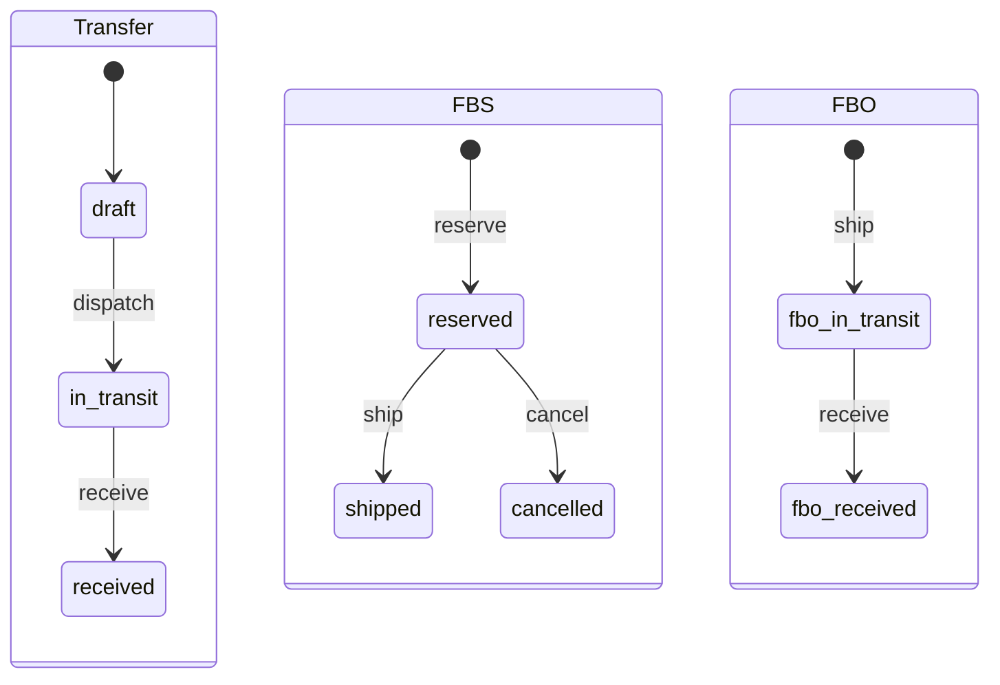

# Решения CheckStock

Контракт: CHECKSTOCK_CODEX_PLAN.md, разделы 0–10. Ниже — проектные договорённости раздела 3, а не цитаты из исходного PDF.

## Границы и архитектура

Один магазин; один SKU и положительное целое количество в операции, только полные отгрузки и приёмки. Python, синхронный FastAPI, SQLAlchemy 2 + psycopg, PostgreSQL, Alembic. PostgreSQL — единственный источник истины. Jinja2 и локальные CSS/JavaScript без frontend-сборки и CDN. Нет интеграций, ролей, частичных приёмок, возвратов, очередей или расчётов закупок. Локальный прототип без аутентификации; публиковать в интернете нельзя. FBS остаётся в пути после shipped: подтверждение доставки за рамками MVP.

## Состояния и изменения количества

| Команда | Физически у источника | Резерв FBS | Транзит | Физически у получателя |
|---|---:|---:|---:|---:|
| receipt completed | +q на выбранном ФФ | 0 | 0 | — |
| transfer create draft | 0 | 0 | 0 | 0 |
| transfer dispatch | −q | 0 | +q между ФФ | 0 |
| transfer receive | 0 | 0 | −q между ФФ | +q |
| FBS reserve | 0 | +q | 0 | — |
| FBS cancel | 0 | −q | 0 | — |
| FBS ship | −q | −q | +q клиенту | — |
| FBO ship | −q | 0 | +q маркетплейсу | — |
| FBO receive | 0 | 0 | −q маркетплейсу | 0 (маркетплейс вне ФФ) |

Нули в таблице означают отсутствие изменения. Доступно = on_hand − reserved_fbs; резерв уже входит в физический запас и не прибавляется к нему. Транзит вычисляется только из операций: transfer/in_transit, fbo/in_transit, fbs/shipped. FBO received отражает местонахождение на маркетплейсе в операции и истории, не в остатках ФФ. Создание transfer не резервирует запас; наличие проверяется при dispatch. Получить draft нельзя.

## Архивация и история

Удаление — установка archived_at, без hard-delete. ID и остатки сохраняются; матрица включает все товары × все склады, в том числе архивные и нулевые сочетания. Новый приход, FBS-резерв, FBO и новое входящее перемещение на архивный ФФ запрещены. Исходящий transfer на активный ФФ разрешён. Уже созданные операции можно завершить, включая приёмку на позднее архивированный склад, отправку и отмену ранее созданного FBS. Арифметический available архивного склада не даёт права на новый резерв. Переименование не меняет ID; журнал сохраняет снимки имён на момент каждого события. Журнал append-only, у событий есть SKU, количество, источник, назначение, UTC-время, ID и статус операции на момент события.

## Транзакции, блокировки, идемпотентность

Сервис не делает commit: вызывающий код выполняет целую команду в одной session.begin(). Проверка, изменение баланса, статус и событие коммитятся вместе; любая ошибка откатывает всё. Для создания используется обязательный idempotency_key, глобально уникальный среди операций, и SHA-256 нормализованного payload с видом операции. Транзакционная advisory-блокировка ключа сериализует одинаковые create; UNIQUE остаётся гарантией БД. Тот же ключ и payload возвращают прежнюю операцию, изменённый payload — 409. При повторе create проверка идемпотентности предшествует проверке текущего состояния склада.

Порядок блокировок: ключ создания или строка существующей операции FOR UPDATE, затем склады по возрастанию ID, затем балансы по (product_id, warehouse_id). Блокировки складов согласуют архивацию/переименование с созданием и завершением операций. Отсутствующий баланс создаётся INSERT ON CONFLICT DO NOTHING, затем SELECT FOR UPDATE. Списание всегда только с выбранного ФФ, без fallback. Повтор перехода определяется уже записанным событием (включая dispatch после receive); возвращается текущее состояние, без повторного эффекта. Противоположный переход FBS после ship/cancel — 409.

## Инварианты и ограничения

- on_hand >= 0; reserved_fbs >= 0; reserved_fbs <= on_hand; qty > 0.
- Уникальны SKU, пара product_id/warehouse_id, idempotency_key, пара operation_id/event_type.
- kind/status и форма источника/назначения согласованы через CHECK; источник transfer отличается от назначения.
- FK без CASCADE на удаление; времена timestamptz UTC.
- transfer/FBO расходуют только available_here; FBS ship расходует собственный резерв.
- Ошибочная команда не создаёт частичного баланса, статуса или события.
- События запрещено UPDATE/DELETE на уровне PostgreSQL; демоприходы создаются тем же сервисом, что обычные приходы.
- Тесты работают в отдельной случайной PostgreSQL-схеме с отдельной миграцией; удаление разрешено только своей схеме test_checkstock_<uuid>. Рабочая public не очищается.

## Ошибки и демонстрационные данные

422 — формат, дробь/ноль/отрицательное количество; 404 — неизвестные SKU/ФФ/операция; 409 — локальный дефицит (available_here, requested), архив, неверный переход, конфликт ключа. Пользователь получает русское объяснение. Строгий int отвергает bool и строки для количества.

Seed запускается явно: три товара и ФФ Север/Юг; четыре положительных прихода 10, 6, 5, 4, всего 25. Нули не создают событий прихода. Идентификаторы справочников и стабильные ключи seed обеспечивают повторяемость, в том числе после переименования склада. Запуск приложения выполняет миграции, но сам не включает демоданные. Docker хранит PostgreSQL в именованном томе.

## Уточнения реализации

Все идентификаторы — UUID; справочники demo имеют детерминированные UUIDv5, обычные записи — UUIDv4. Это предотвращает конфликт seed с ранее созданными складами и не привязывает повтор к имени. Команды используют READ COMMITTED и блокировки; блокирующие ORM-запросы перечитывают поля через populate_existing. В небольшом прототипе блокировка склада также сериализует команды разных SKU этого ФФ: осознанный компромисс в пользу простоты согласования с архивацией. Отчёты API читаются в одной REPEATABLE READ транзакции, чтобы матрица и транзит отражали один снимок, даже если параллельно идёт отправка. Количества ограничены положительным PostgreSQL integer; переполнение итогового баланса отклоняется как доменный конфликт.
